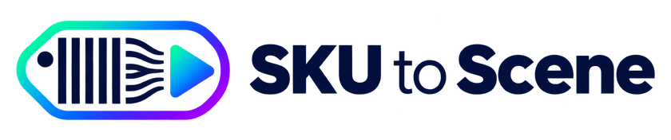
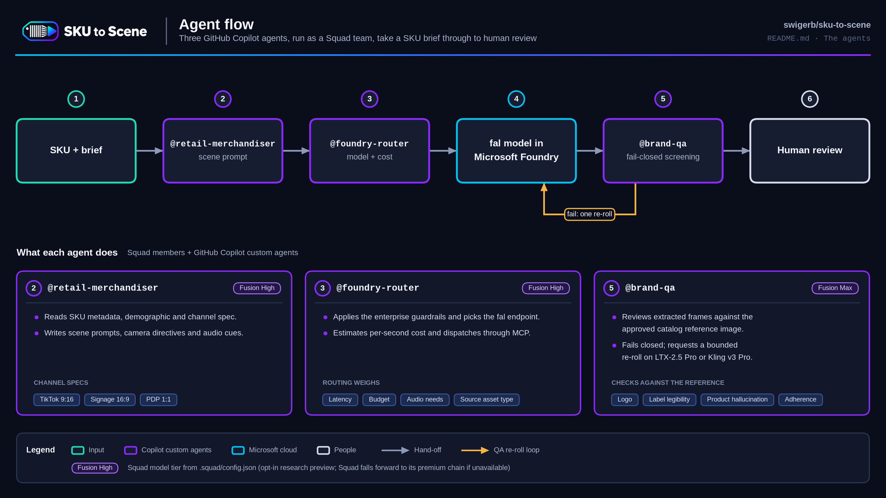

<p align="center">
  <picture>
    <source media="(prefers-color-scheme: dark)" srcset="assets/brand/web/logo-horizontal-dark.png">
    
  </picture>
</p>

<p align="center"><strong>AI-Directed Retail Video for product catalogs</strong><br />
<sub>Curated technical reference preview · fictional brands · not approved for customer campaigns</sub></p>

<p align="center">
  <a href="https://swigerb.github.io/sku-to-scene/"><strong>▶ Open the browser demo</strong></a> ·
  <a href="docs/demo-script.md">Demo script</a> ·
  <a href="docs/architecture.md">Architecture</a> ·
  <a href="docs/verification.md">Verification</a>
</p>

**SKU to Scene shows how retail teams can turn static product catalog assets into short video concepts.** Start
with a product SKU (an approved catalog image or a text brief) and a merchandising goal. Three GitHub Copilot
agents write the scene, choose the best-fit **fal video model in Microsoft Foundry**, estimate the cost and screen
the result before a person reviews it.

- **Five Foundry video models, one routing decision.** `Kling v3 Pro`, `LTX-2.5 Fast`, `LTX-2.5 Pro`,
  `MiniMax H3 Max` and `MiniMax H3 Max Turbo` trade off product fidelity, audio, layout control, speed and cost.
  The router picks one from the brief's latency, budget, audio and source-asset needs.
- **Multi-agent orchestration in Copilot.** The agents run as a [Squad](https://github.com/bradygaster/squad) team
  with Copilot Fusion model routing (preview).
- **Recorded, inspectable evidence.** The browser demo replays real Foundry renders for 14 fictional retail
  examples, with their routing rationale, cost estimates, QA screening and, where run, AI evaluations.

> [!IMPORTANT]
> The browser demo replays recorded clips and makes no cloud calls. Brands and products are fictional. Automated
> QA and AI evaluations are screening aids: no clip is approved for a customer campaign, and every output needs
> human review. fal models run outside Microsoft facilities; read
> [Live mode](#live-mode-optional-deliberate-and-billable) before enabling them.

## Quick tour

<div align="center">

https://github.com/user-attachments/assets/11dc2974-3699-410b-a52c-361e454d6669

</div>

<div align="center">
  <sub><strong>2 min 6 s</strong> &nbsp;·&nbsp; Microsoft Ava AI narration &nbsp;·&nbsp; Music: <em>Blueprints for Tomorrow</em><br />
  <a href="https://github.com/swigerb/sku-to-scene/releases/download/media-v2/sku-to-scene-sizzle-v2.mp4">Captioned 1080p</a> &nbsp;·&nbsp; <a href="https://github.com/swigerb/sku-to-scene/releases/download/media-v2/sku-to-scene-sizzle-v2-clean.mp4">Clean 1080p master</a> &nbsp;·&nbsp; <a href="https://github.com/swigerb/sku-to-scene/releases/download/media-v2/sku-to-scene-sizzle-v2.srt">Captions</a></sub>
</div>

Explore the guided workflow, retail and consumer-goods examples, model routing, cost estimates and quality
evidence. Recorded footage; human review required.

[Previous overview](https://github.com/swigerb/sku-to-scene/releases/tag/media-v1)

## What you're looking at

The [browser demo](https://swigerb.github.io/sku-to-scene/) has five pages:

| Page | What it shows |
| --- | --- |
| **Home** | The idea in one screen: a product image beside its recorded video, retail example entry points and the overview video |
| **Guided demo** | One fictional account at a time: Brief → Concepts (Northwind only) → Recorded result → Review |
| **Scenario gallery** | The eight featured presentations, with the six learning cases collapsed under **Learning cases and known limitations** |
| **Technical evidence** | Routing, cost estimates, brand QA screening and AI evaluations for the selected recording, with historical evidence kept separate |
| **About** | What the demo is and isn't, data processing, governance caveats, sources and license |

For the presenter walkthrough, see the [demo script](docs/demo-script.md).

### Curated scope

| Population | Count | Accounts |
| --- | :---: | --- |
| Featured presentations | 8 | Northwind¹, Tailspin, Coho, Fabrikam, VanArsdel, Zava¹, Proseware², Munson |
| Learning cases | 6 | Alpine, Woodgrove, Southridge, Tailwind, Wide World, Best For You |
| Rejected replacement attempts | 6 | None selected; none published |

¹ Silent presentation derivative: the recorded video with its audio removed (Northwind because of a human-review
audio finding, Zava because the audio was not requested). The native originals stay in source history.<br />
² Shown with a disclosed background variance from its brief.

The featured presentations and learning cases cover all 14 fictional accounts. Each learning case keeps its
original recording and an unresolved defect that still needs a replacement; the six rejected attempts were
those replacements, not additional examples. Source: [curated scope v1](demo-cache/evaluations/curated-release-v1.json).

### How to read the results

- **QA screens; it does not approve.** `@brand-qa` recorded 2 pass / 6 fail for the original eight clips. A pass
  still needs human sign-off (`publish_approved` stays false).
- **AI evaluations sit beside QA verdicts and never change them.** Foundry Evals v1 covered the original clips, a
  negative control and the router's decisions ([details](docs/foundry-evaluations-plan.md)). The later
  [targeted checks](demo-cache/evaluations/targeted-evals-v2.json) used direct Azure OpenAI review, not the Foundry
  Evals service.
- **Human feedback is labeled as such.** The only confirmed human finding is the presenter's note that
  Northwind's native hero audio is loud and doesn't match the picture. Other review notes identify their
  agent or evaluator source.
- **The nine newer accounts are exploratory drafts.** Their silent text-to-video clips passed automated screening
  but have no Foundry evaluation or human approval ([account drafts](docs/verification.md#account-drafts)).
- **Costs are estimates.** They're preview list price × requested seconds, not an Azure bill. The release pass
  recorded $3.7032 in conservative consumed reservations.

## The agents



| Agent | Input | Output |
| --- | --- | --- |
| `@retail-merchandiser` | SKU metadata, audience and channel (TikTok 9:16, signage 16:9, PDP 1:1) | Scene prompt, camera directions and audio cues |
| `@foundry-router` | Scene brief and enterprise guardrails | fal model choice, per-second cost estimate and dispatch through the MCP server |
| `@brand-qa` | Generated frames and the approved catalog image | Fail-closed screening for logo, label and product fidelity; one bounded re-roll on LTX-2.5 Pro or Kling v3 Pro |

Each agent is a Squad member (`.squad/`) and a Copilot custom agent (`.github/agents/`). `.squad/config.json`
opts into Copilot Fusion: Fusion High for the team and Fusion Max for `@brand-qa`. If Fusion is unavailable,
Squad falls back to its premium model chain. See
[Copilot Fusion model routing](docs/architecture.md#copilot-fusion-model-routing).

## Why five model variants matter

Each model has a different strength, so `@foundry-router` routes on signals in the brief:

| Signal in the brief | Route | Why |
| --- | --- | --- |
| Draft or A/B testing | LTX-2.5 Fast or MiniMax H3 Max Turbo | Fast, low-cost iteration |
| Approved PIM hero image + native audio | Kling v3 Pro image-to-video | Keeps the approved product image |
| Strict multi-object layout | MiniMax H3 Max | Close adherence to technical constraints |
| Final text-led cut with synchronized audio | LTX-2.5 Pro | Native audio at final quality |
| High volume, such as weekly circulars | MiniMax H3 Max Turbo | Half the per-second rate of H3 Max |
| Budget cap exceeded | Next-cheapest compatible model, or a rejection with reasons | Stays within budget |

Every decision returns a rationale, the skipped candidates, a payload preview and a cost estimate. Prices and
payload limits: [model routing](docs/model-routing.md).

| Retail area | Fictional example (representative account) | Video need | Recorded model | Curated role |
| --- | --- | --- | --- | --- |
| QSR / coffee / convenience | Northwind Coffee (Starbucks) | Seasonal launch: three drafts, then a hero | Drafts: MiniMax H3 Max Turbo, LTX-2.5 Fast · Hero: Kling v3 Pro | Featured |
| QSR / coffee / convenience | Tailspin Burger Co. (McDonald's) | Value-bundle creative | LTX-2.5 Fast | Featured |
| QSR / coffee / convenience | Coho Corner Market (7-Eleven) | Fresh-food handoff | MiniMax H3 Max Turbo | Featured |
| Apparel / home decor | Fabrikam (Gap) | Approved jacket lookbook | Kling v3 Pro | Featured |
| Apparel / home decor | VanArsdel Finds (TJX) | Changing assortment discovery | MiniMax H3 Max Turbo | Featured |
| Apparel / home decor | Tailwind Traders (Target) | Home-decor newness | LTX-2.5 Fast | Learning case |
| Apparel / home decor | Wide World Wholesale (Costco) | Warehouse essentials | MiniMax H3 Max Turbo | Learning case |
| Home / electronics | Alpine Pro Supply (The Home Depot) | Contoso Pro drill in context | Kling v3 Pro | Learning case |
| Home / electronics | Zava DIY (Lowe's) | Fabrikam Home patio layout (text-only) | MiniMax H3 Max | Featured |
| Home / electronics | Southridge Electronics (Best Buy) | Litware laptop content | MiniMax H3 Max | Learning case |
| Home / electronics | Proseware Workplace Supply (Staples) | Workplace-kit arrangement | MiniMax H3 Max | Featured |
| Grocery / pharmacy | Woodgrove Wellness (Walgreens) | Calm seasonal wellness screen | MiniMax H3 Max Turbo | Learning case |
| Grocery / pharmacy | Best For You Market (Kroger) | Weekly meal inspiration | MiniMax H3 Max Turbo | Learning case |
| Grocery / pharmacy | Munson's Markets (Albertsons) | Localized grocery basket | MiniMax H3 Max Turbo | Featured |

**Fictional brands and products.** Real company names identify representative retail segments and cite public
sources only; no affiliation, endorsement, trademarks or customer data. Each example is inspired by the
qualitative public priorities cited in [`catalog/accounts.json`](catalog/accounts.json), not by a relationship
or private plans.

### Aim for photographic realism

Describe real-world environments, believable materials, natural lighting and photographic camera language;
the word "photorealistic" alone isn't enough. Approved product photography with **Kling v3 Pro
image-to-video** is the strongest lever for recognizable products. Busier scenes raise the risk of accidental
text, logos and trade dress, so focus QA and human review on those details, product identity, physics and
framing. Realistic-looking footage is still AI-generated; describe it that way.

## Quickstart (no Azure, no spend)

Requires Python 3.11+ and ffmpeg on `PATH`.

```powershell
python -m venv .venv; .\.venv\Scripts\Activate.ps1
pip install -e ".[dev]"
$env:SKU2SCENE_MODE = "mock"; $env:SKU2SCENE_QA_EVALUATORS = "off"   # rehearsal: no cloud calls
pytest -q
sku2scene route --brief briefs\qsr-lto-pumpkin-cold-brew.json
sku2scene demo lto --step drafts
sku2scene demo lto --step hero --select 2
sku2scene ledger
```

In the Copilot app, the `sku-to-scene` MCP server (`.mcp.json`) is preconfigured for the same no-spend rehearsal.

To preview the browser demo locally, run `python scripts\build_site.py`, then
`python -m http.server 8765 --directory _site`, and open http://127.0.0.1:8765/.

## Live mode (optional, deliberate and billable)

You don't need live calls for the browser demo or the presenter path. Live generation was validated once, on
2026-11-16, across all five variants ([record](docs/live-validation.md)).

> [!WARNING]
> **fal models on Foundry are a preview and run outside Microsoft facilities.** Enabling them means you elect to
> send data to fal; **Microsoft customer agreements, the Product Terms/DPA and Microsoft certifications do not
> apply** to that processing. See [governance](docs/governance.md).

To use your own Foundry resource:

1. Choose a non-production subscription. An administrator reviews fal's preview terms, then registers
   `Fal.EnableDeploy`.
2. Deploy the five models (requires **Foundry Owner**).
3. Assign callers **Cognitive Services User** or **Foundry User** on the resource.
4. Copy `.env.example` to `.env` (ignored by Git). Set `SKU2SCENE_MODE=live`, `FOUNDRY_ENDPOINT`, the
   `FOUNDRY_DEPLOYMENT_*` names and, if needed, `FOUNDRY_TENANT_ID`.
5. Run `pip install -e ".[live]"`, then the read-only check `sku2scene readiness --check-auth`.

Authentication uses Entra ID by default. `FOUNDRY_API_KEY` is optional, only when local auth is enabled on the
resource. No fal.ai `FAL_KEY` is used. Step-by-step: [Foundry setup](docs/foundry-setup.md).

## Documentation

| Doc | Covers |
| --- | --- |
| [Demo script](docs/demo-script.md) · [Prep checklist](docs/prep-checklist.md) | 15-minute executive pitch and rehearsal |
| [Architecture](docs/architecture.md) | Flow, CLI/MCP tools, agents, Fusion routing, static site |
| [Model routing](docs/model-routing.md) | Routes, payload constraints, pricing, routing policy |
| [Foundry setup](docs/foundry-setup.md) | Provisioning, RBAC, auth troubleshooting, optional QA vision |
| [Governance](docs/governance.md) | fal data handling, fail-closed QA, provenance |
| [Live validation](docs/live-validation.md) | Measured smoke runs, cache, QA results, spend |
| [Verification and troubleshooting](docs/verification.md) | Remaining limitations, recovery, bug-report template |
| [Foundry Evaluations](docs/foundry-evaluations-plan.md) | Executed v1 runs, results, cost, opt-in runner, next phases |
| [ComfyUI](docs/comfyui.md) | Optional visual track |

## Sources

- [Building the next generation of multimodal AI experiences with fal in Microsoft Foundry](https://techcommunity.microsoft.com/blog/azure-ai-foundry-blog/building-the-next-generation-of-multimodal-ai-experiences-with-fal-in-microsoft-/4570032)
- [Direct your next shot with fal on Microsoft Foundry and ComfyUI](https://techcommunity.microsoft.com/blog/azure-ai-foundry-blog/direct-your-next-shot-with-fal-on-microsoft-foundry-and-comfyui/4570230)
- [Microsoft Learn: Enable fal models in Microsoft Foundry](https://learn.microsoft.com/azure/foundry/how-to/fal-ai-models/enable-fal-models)

## License

MIT. Product images are AI-generated for fictional brands. SKU to Scene logo and icon assets are in
[`assets/brand/`](assets/brand/).
