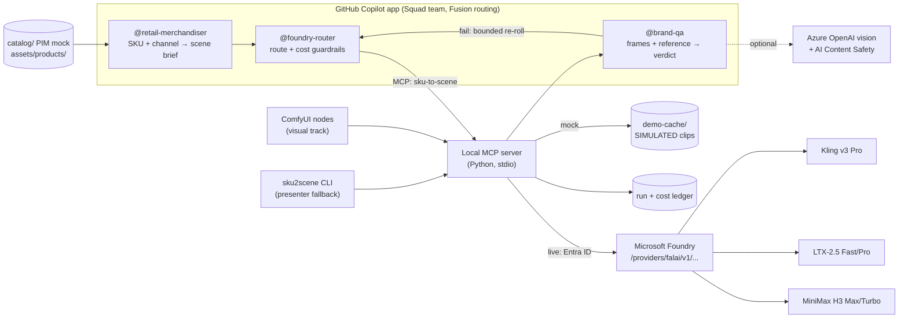

# SKU to Scene

### AI-Directed Retail Video at Enterprise Scale

Turn static product catalog assets (approved PIM imagery and text briefs) into channel-ready video with an
**agent-orchestrated creative supply chain**. Three GitHub Copilot agents, run as a [Squad](https://github.com/bradygaster/squad)
team, route each merchandising brief to the right **fal video model in Microsoft Foundry**: `Kling v3 Pro`,
`LTX-2.5 Fast`, `LTX-2.5 Pro`, `MiniMax H3 Max` or `MiniMax H3 Max Turbo`. Routing weighs latency, budget, audio
needs and source asset type.

> [!WARNING]
> **The fal models on Foundry are a preview. They run outside Microsoft facilities.** Microsoft Learn says that
> enabling them means you *elect to send your data to fal*. **Microsoft customer agreements, the Microsoft Product
> Terms/DPA and Microsoft certifications do not apply** to that processing; fal's own terms do. Before anyone
> registers the `Microsoft.CognitiveServices/Fal.EnableDeploy` preview feature, an administrator must review and
> accept those terms. This repo never registers features, accepts terms or provisions resources for you. See
> [docs/governance.md](docs/governance.md).

> [!IMPORTANT]
> **Every clip in this repo is a SIMULATED placeholder**, not a Foundry render. The clips are built locally with
> ffmpeg from the product images and labelled `provenance: "simulated"` in `demo-cache/manifest.json`. The demo
> runs end to end offline in **mock mode**. **Live mode** (`SKU2SCENE_MODE=live`) calls real Foundry fal routes.
> No live render has been produced or verified yet; see [Current status](#current-status--blockers).

## Why five model variants matter: RCG routing

| RCG vertical | Representative accounts* | Demo use case | Foundry model(s) | Why this model wins |
| --- | --- | --- | --- | --- |
| Apparel & Home Decor | Gap, TJX, Target, Costco | **PDP image-to-video lookbooks**: animate a flat-lay or ghost-mannequin shot into fabric movement and showroom scenes | **Kling v3 Pro** (I2V) | Keeps SKU visual fidelity from the approved PIM image while adding fabric physics and camera motion |
| QSR, Coffee & C-Store | McDonald's, Starbucks, 7-Eleven | **Rapid LTO social ads**: steam, ice clinks, pour shots | **LTX-2.5 Fast → LTX-2.5 Pro** / **Kling v3 Pro** | Iterate concepts cheaply on the fast tier, then render the winner with native audio |
| Home Improvement & Electronics | The Home Depot, Lowe's, Best Buy, Staples | **In-context and assembly previews**: products on a job site or in a home office | **Kling v3 Pro + MiniMax H3 Max** | Kling handles physical interaction; H3 Max follows strict multi-object layout constraints |
| Grocery & Pharmacy | Kroger, Albertsons, Walgreens | **High-volume weekly circulars and digital endcaps** | **MiniMax H3 Max Turbo** | **Half the per-second rate of H3 Max**, so high-SKU weekly personalization is affordable |

\*Illustrative account types only. All demo brands are fictional: **Northwind Coffee**, **Contoso Pro**,
**Fabrikam** and **Woodgrove Wellness**. No real logos or trademarks are used.

Routing rules in `src/sku_to_scene/router.py`, each decision with an explanation:

- Drafting or A/B testing → `LTX-2.5 Fast` or `MiniMax H3 Max Turbo` (Turbo for volume)
- Approved hero image + native audio → `Kling v3 Pro` image-to-video
- Strict multi-object layout → `MiniMax H3 Max`
- Text brief + synchronized audio, final quality → `LTX-2.5 Pro`
- Budget caps reserve the worst-case duration (`auto` is priced at the model maximum). Unsupported settings are
  rejected or rerouted, never sent. One example: LTX has no 1:1, so square PDP output uses a documented
  crop policy.

Details, prices and sources: [docs/model-routing.md](docs/model-routing.md).

## Architecture



## Quickstart (mock mode, no Azure)

Requirements: Python 3.11+ and ffmpeg on `PATH` (for frame extraction and crops).

```powershell
python -m venv .venv; .\.venv\Scripts\Activate.ps1
pip install -e ".[dev]"
pytest -q                                          # 54 tests, offline

sku2scene models                                   # the five models, routes, preview prices
sku2scene route --brief briefs\qsr-lto-pumpkin-cold-brew.json
sku2scene demo lto --step drafts                   # Step 2a: three fast-tier drafts + adherence QA
sku2scene demo lto --step hero --select 2          # Step 2b: presenter picks #2 → Kling v3 Pro hero + audio
sku2scene ledger                                   # one meter across all models (estimates, not bills)
sku2scene readiness                                # read-only live-mode checklist
```

Set `SKU2SCENE_MOCK_LATENCY_SCALE=1` on stage to simulate realistic per-model render times.

### Runtime interface

**CLI** (`sku2scene --help`): `models`, `catalog`, `scene`, `route`, `estimate`, `generate`, `qa`, `reroll`,
`ledger`, `jobs`, `readiness` and `demo lto --step drafts|hero`.

**MCP server** `sku-to-scene` (stdio). It is registered in `.mcp.json`, `.copilot/mcp-config.json` and
`.vscode/mcp.json` as `python scripts/run_mcp_server.py`. That is a stdlib-only launcher which always runs the
server with the repository's `.venv` interpreter. MCP hosts don't inherit shell activation, so complete the
quickstart install into `.venv` first. Override the interpreter with `SKU2SCENE_PYTHON`, and use `python3` as
the command on macOS/Linux if `python` isn't on `PATH`. If `.venv` is missing, it prints setup steps and exits.
`python scripts/verify_mcp_stdio.py` runs initialize → tools/list → tools/call through that exact launcher from a
de-activated environment. The server exposes these tools:

- Catalog and briefs: `list_models`, `search_catalog`, `get_sku`, `compose_scene`
- Routing and cost: `route_brief`, `estimate_cost`
- Generation: `generate_video(model, prompt, image_path, duration, ...)`, `generate_drafts`
- LTO flow: `lto_draft_concepts`, `lto_render_hero(select)`, `run_lto_demo`
- Jobs and QA: `job_status`, `extract_frames`, `evaluate_brand_compliance`, `reroll_clip`
- Reporting: `cost_report`, `foundry_readiness`

## The agents (Squad 1.1.0 + Copilot custom agents)

| Agent | Role |
| --- | --- |
| `@retail-merchandiser` | Reads SKU metadata, demographic and channel spec (TikTok 9:16, Signage 16:9, PDP 1:1). Writes scene prompts, camera directives and audio cues. |
| `@foundry-router` | Applies the enterprise guardrails, picks the fal endpoint, estimates per-second cost and dispatches through MCP. |
| `@brand-qa` | Reviews extracted frames **against the approved catalog reference image** (logo, label legibility, product hallucination, adherence). Fails closed; requests a bounded re-roll on LTX-2.5 Pro or Kling v3 Pro. |

The agents are defined in two places:

- **Squad members**: `.squad/agents/<name>/charter.md`, with routing in `.squad/routing.md`
- **Copilot custom agents**: `.github/agents/<name>.agent.md`, so you can address them as `@retail-merchandiser`,
  `@foundry-router` and `@brand-qa` in the app

Scaffolded with `@bradygaster/squad-cli` **1.1.0**, the npm `latest` dist-tag when this was built.
`.mcp.json` pins `@bradygaster/squad-cli@1.1.0`.

### Copilot Fusion model routing

`.squad/config.json` follows Squad 1.1.0's model-selection layers:

```json
{ "defaultModel": "hydrafusion", "agentModelOverrides": { "brand-qa": "hydrafusion-max" } }
```

`hydrafusion` (Fusion High) drives the team, and `brand-qa` gets `hydrafusion-max` (Fusion Max) for vision-heavy QA.
Squad's own template calls these an **opt-in research preview that may be unavailable** (for example, when
preview models are disabled by policy). If `hydrafusion` is unavailable, Squad falls forward to the head of its
quality-first premium chain and records the spawn with source `fallback` and a rationale naming the unavailable
model, so the demo never claims Fusion is guaranteed. Picking a session model in the app is inherited by every
sub-agent spawn. In the Copilot app you can
also choose **Auto → Fusion tier (High / Max)** in the model picker for the whole session. The `.agent.md` files
deliberately omit a `model:` field; model choice stays with Squad config and the app.

## Live mode (Microsoft Foundry)

1. An administrator reviews the fal preview terms (see the warning above), then registers `Fal.EnableDeploy`
   on a **designated non-production demo subscription**.
2. Deploy the five models. Kling v3 Pro uses the US Data Zone offering; LTX and MiniMax use Global Standard
   (PayGo). See [docs/foundry-setup.md](docs/foundry-setup.md).
3. Copy `.env.example` to `.env`, then set `SKU2SCENE_MODE=live`, `FOUNDRY_ENDPOINT=https://<resource>.services.ai.azure.com`
   and the deployment names. Sign in with `az login`; auth uses `DefaultAzureCredential` with the Cognitive
   Services User role. **A fal.ai `FAL_KEY` is not used.**
4. `pip install -e ".[live]"`, run `sku2scene readiness --check-auth`, then
   `python scripts/precache.py --yes` to replace the simulated clips with real renders, with provenance recorded.

**Route prefix:** the Learn route list shows `/providers/falai/<model>/...`, but the Learn code samples and the
ComfyUI article use `/providers/falai/v1/...`. The default is `providers/falai/v1`; override it with
`FOUNDRY_FAL_ROUTE_PREFIX`.

## Docs

- [15-minute executive demo script](docs/demo-script.md), with talk track and fallback cues
- [Foundry setup and provisioning](docs/foundry-setup.md)
- [Model routing and pricing reference](docs/model-routing.md)
- [Governance, data handling, Content Safety and Evaluations](docs/governance.md)
- [ComfyUI optional visual track](docs/comfyui.md)
- [Demo prep checklist](docs/prep-checklist.md)

## Current status / blockers

- ✅ Mock mode works end to end locally: CLI, MCP server over stdio through the configured launcher, Squad and
  Copilot agents, and the pytest suite. CI (`.github/workflows/ci.yml`) runs the same checks.
- ⛔ **No live Foundry render or endpoint has been configured or verified for this demo.** In the build
  environment no demo Foundry endpoint was configured, and `Fal.EnableDeploy` showed as not registered on the
  subscription that was checked. Live use needs a designated demo target and administrator review of the fal
  terms. Every `demo-cache/` clip is simulated.
- ⚠️ QA scores in mock mode are **scripted rehearsal values** (`measured: false`). `publish_approved` stays
  false until a real vision evaluator is configured.
- ⚠️ Prices are **preview list prices × requested seconds**. These are estimates, not bills. MiniMax outputs can
  run about 0.7 s longer than requested.

## Sources

- [Building the next generation of multimodal AI experiences with fal in Microsoft Foundry](https://techcommunity.microsoft.com/blog/azure-ai-foundry-blog/building-the-next-generation-of-multimodal-ai-experiences-with-fal-in-microsoft-/4570032)
- [Direct your next shot with fal on Microsoft Foundry and ComfyUI](https://techcommunity.microsoft.com/blog/azure-ai-foundry-blog/direct-your-next-shot-with-fal-on-microsoft-foundry-and-comfyui/4570230)
- [Microsoft Learn: Enable fal models in Microsoft Foundry](https://learn.microsoft.com/azure/foundry/how-to/fal-ai-models/enable-fal-models)
- [Squad model selection](https://github.com/bradygaster/squad/blob/dev/docs/src/content/docs/features/model-selection.md)

## License

MIT. Product images are AI-generated for fictional brands.
