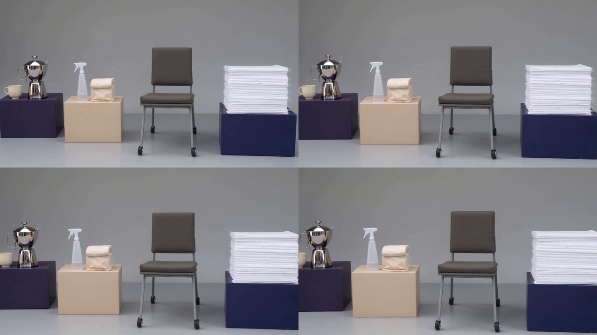
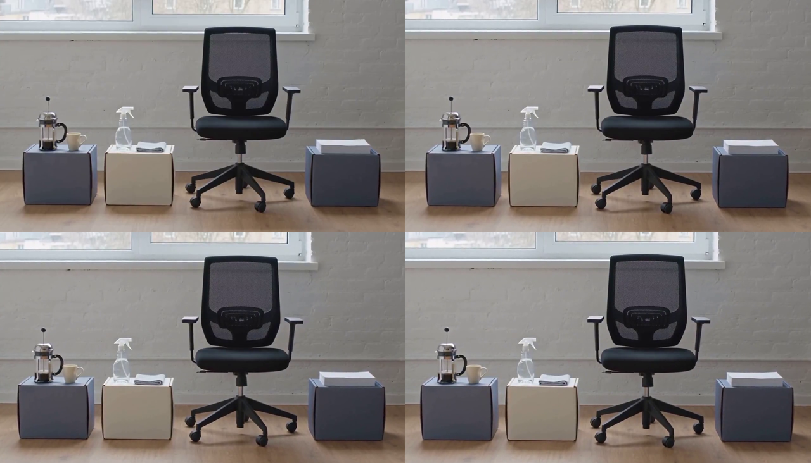
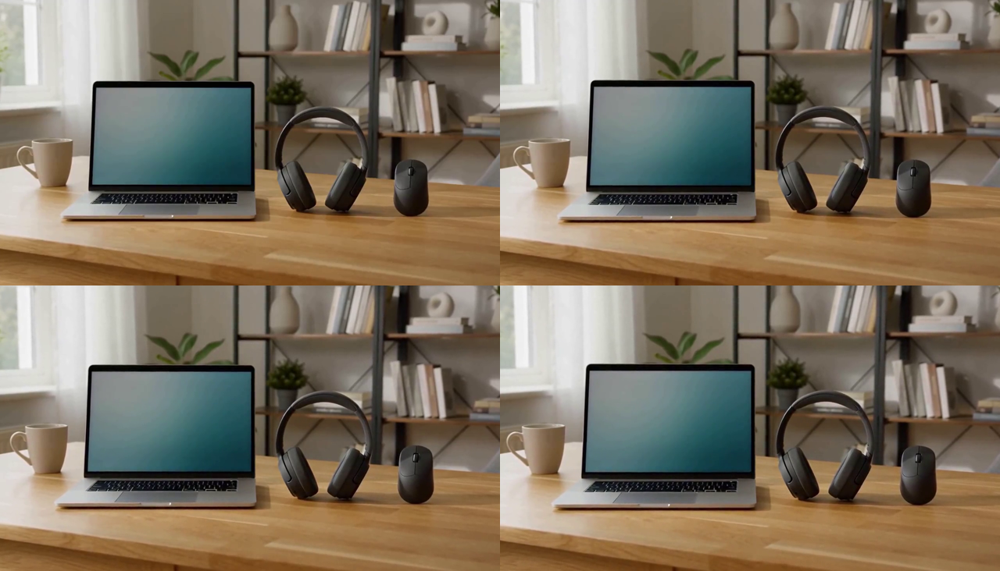

# Verifying the remaining limitations and troubleshooting

What is proven, what still needs a human, how to check it safely and what to do when something looks wrong.
Default to the **cheapest surface that answers the question**:

| Surface | Use it for | Cloud calls |
| --- | --- | --- |
| Browser replay (GitHub Pages or `_site/` locally) | Watching recorded clips and recorded QA evidence | None |
| CLI / MCP with `SKU2SCENE_MODE=mock` and `SKU2SCENE_QA_EVALUATORS=off` | Rehearsing routing, cost, ledger and agent flow | None |
| CLI / MCP with `SKU2SCENE_MODE=live` | A deliberate, authorized new render or QA run | **Billable** |

`SKU2SCENE_MODE=mock` alone is not no-spend: if `.env` configures vision or Content Safety, QA still calls them.
Set `SKU2SCENE_QA_EVALUATORS=off` too (the repository MCP configs already do).

## Local release pass (2026-11-17)

The [asset-bound demo dispositions](../demo-cache/evaluations/demo-dispositions-v1.json) distinguish
fictional-demo use, historical screening and customer-campaign approval. Northwind and Zava use separately
identified silent derivatives with native originals retained. Removing audio is not evidence that native audio
became acceptable. Concept #2's silence is expected.

[Contoso rule v2](../catalog/contoso-pro-v2.json) makes the approved black/teal PIM authoritative for new work;
the original 0.72/0.75 prompt failure and split evaluation are unchanged. Woodgrove's thermometer and honey
are visible early; later cropping and weak pharmacy context remain. Proseware's window/wall background is an
explicit fictional-demo variance, not exact compliance with the original no-window brief.

The separate, explicitly approved $4 planned-spend envelope covers one attempt each for six
[versioned replacement briefs](../briefs/release-20261117.json), six bounded v1 QA callsets, and three bounded
direct Azure OpenAI evaluations. No generation or evaluator retries are permitted. Failed/uncertain reservations
are not refunded into the cap. `scripts/render_release.py` maintains the separate private
`.sku2scene/release-20261117-reservations.json`; the exhausted account-draft journal is untouched.
`scripts/evaluate_release.py` uses a hard completion-token bound, not an unbounded Foundry Evals label-model run.
The [grocery rationale v2](../briefs/grocery-routing-rationale-v2.json) retains the route and removes unsupported
quality guarantees. Original Foundry Evals records remain separate.

All six generation attempts and their QA completed. None is selected; native source and presentation candidates
are retained in the private review package, while public media paths remain unavailable.

| Candidate | Measured QA | Final demo disposition |
|---|---|---|
| Alpine | Fail | Rejected: distorted wordmark and mirrored battery text. |
| Woodgrove | Fail | Rejected: fine-label degradation, invented signage and push-in. Lemon/basket objections are grader errors, not permission to override the fail. |
| Southridge | Fail | Rejected: fixed viewpoint and full-object framing fail. The mouse is flat; the contrary grader claim is retained as calibration evidence. |
| Tailwind | Pass | Unselected: wall fixed, but push-in half-crops both lamps and changes the palette. Automated pass is not acceptance. |
| Wide World | Pass | Unselected: full-frame review finds background label/barcode-like marks and signage. Automated screening missed them. |
| Best For You | Fail | Unselected: no utensils, but unchanged gate fails. Plural carrots and blank box interior were requested; those grader objections are false negatives. |

[Targeted evaluations](../demo-cache/evaluations/targeted-evals-v2.json): Zava concept **partial**, supported grocery
rationale **grounded**, deliberately unsupported guarantee **ungrounded**. This narrow calibration is not a
reliability study. Zava's centering/decor caveat and sampled-frame limitation remain visible; branding/PIM checks
are not applicable. Total conservative consumed reservations are **$3.7032** ($2.8032 generation, $0.60 QA,
$0.30 targeted evaluation), with **$0 outstanding reservations**. These are retained planning bounds, not an invoice.
No further paid calls or retries were made.

Pre-curation local validation: 203 pytest tests and 218 real Chromium checks passed. The independent HTTP/provenance
audit passed 19 checks. A separate native Edge browser-menu 200% integration smoke passed, including the
corrected recorded-result playback accessible name after Refresh; this is bounded coverage, not all 14 examples
at 200%, and no native screenshot export is claimed. Earlier pre-integration zoom evidence remains separate.
Safari is unqualified; browser-engine automation does not substitute for it.

## Curated technical reference preview (v1)

[Curated scope v1](../demo-cache/evaluations/curated-release-v1.json) (`curated-reference-preview-20261117-v1`,
based on the demo dispositions above) defines a finite reference preview. It does not change any disposition,
threshold, score, rejection or withheld status, and it is not customer-campaign approval.

- **Featured presentations (8):** Northwind (silent derivative), Tailspin, Coho, Fabrikam, VanArsdel, Zava
  (silent generic-layout derivative; targeted evaluation partial), Proseware (background variance) and Munson.
- **Learning cases and known limitations (6), unresolved:** Alpine (original prompt failure needs replacement),
  Woodgrove (later cropping, weak pharmacy context), Southridge (laptop/accessory order), Tailwind (writing-like
  wall marks), Wide World (carton and shelf/bottle markings) and Best For You (excluded utensils remain).
- **Rejected replacement attempts (6):** none selected; their media stays private and 404 on the site.

These are different populations, not a total. `curated_reference_preview_ready` is true;
`full_remediation_complete` and `customer_campaign_approved` stay false, and `release_ready` in the dispositions
keeps its full-remediation meaning. The builder refuses a scope file that promotes a learning case, omits or
duplicates an account, selects a rejected attempt or claims campaign approval.

Curated local validation at `76fee24` (offline; no generation, evaluation or billable calls):

- **pytest:** 222 passed. Source mutations turn the browser assertions red when featured defaults, learning-case
  labels, selector groups or once-only defect text regress, and a builder test refuses a scope that promotes a
  learning case or mismatches the dispositions.
- **Chromium acceptance:** 366/366 checks at 1366×768 and 390×844, 0 page errors, covering Home, gallery
  featured/learning split, learning disclosure, guide selector groups, learning-case brief/preview/review notices,
  original deep links and evidence.
- **Release gates (CRLF worktree preview):** 99/99. A clean build of that Windows worktree (98 files)
  is byte-identical to the served preview; no private
  paths, session identifiers or secrets; published media equals referenced media; the 16 withheld clips
  (10 original, 6 rejected replacement attempts) carry no media; selected-asset and curated clip hashes match;
  tracked recordings and evaluation files are unchanged. Over HTTP, 26 withheld or rejected media URLs returned
  404 and the 14 selected media URLs returned 200.
- **Committed-LF build (`76fee24`):** acceptance 366/366 and release gates 97/97. A blob-for-blob
  archive comparison covers the two omitted Git-only gates. Compared with the CRLF preview, 95/98 output files
  are byte-identical; `app.css` and `app.js` differ only in line endings, and `index.html` only in derived
  cache-bust fingerprints.
- **Native Edge 200% (bounded; CRLF preview):** browser-menu zoom on the changed gallery, learning disclosure, example selector,
  learning-case brief and Home surfaces passed. Unchanged flows keep the earlier integrated native audit. Physical
  screen pixels only; no CSS viewport claim.

The branch is pushed for review only: no merge or Pages deployment. Safari remains unqualified.

## Focused UX regression checks

The hero columns are top-aligned so the source-history disclosure cannot recenter the copy.
Home and About are routed destinations; `#top` and `#about-demo` remain aliases.
Informational anchors do not dispatch a new guide route. Selected-recording evaluations and
additional notes are separate from the historical comparisons and run provenance.

Run the offline Python suite with `SKU2SCENE_MODE=mock` and `SKU2SCENE_QA_EVALUATORS=off`.
For actual layout/history acceptance, build an unchanged dev baseline and the candidate into separate
directories and serve them on separate local ports. With an existing Playwright/Chromium installation:

```powershell
$env:PLAYWRIGHT_MODULE = 'C:\path\to\node_modules\playwright'
$env:BASELINE_SHA = '<actual dev baseline SHA>'
node tests\ux-regressions.cjs http://127.0.0.1:8771/ http://127.0.0.1:8772/ C:\path\to\artifacts
```

The harness blocks non-preview origins, waits for fonts, measures document-space headline,
description and CTA coordinates before expansion, after expansion and after collapse, and
enforces a 2px maximum at 1366x768, 1440x900 and 390x844 in both themes. It writes paired
full-page screenshots and `ux-evidence.json`, including actual Back/Forward guide snapshots,
keyboard Home navigation and populated, empty, targeted, derivative and unavailable review states.
It also guards against literal null placeholders and excessively nested evaluation disclosures.
Inspect the expanded screenshots, including interpretation and historical tables, before review.
This is not a CLS-only test or a claim of campaign approval.

The shared-frame/footer refinement has a separate visual harness, using the previous PR6
preview as its before baseline:

```powershell
node tests\shared-frame.cjs http://127.0.0.1:8772/ http://127.0.0.1:8774/ C:\path\to\frame-artifacts
```

It measures the normal 1240px shell, content/footer edges and header alignment for all five
routes at 1366, 1440, 1920, 800 (tablet) and 390px in both themes. It records actual fullscreen
entry/exit widths, all Northwind guide steps, the remaining examples at desktop/phone widths,
keyboard/touch-target footer checks and optional-node placeholder checks for every gallery category.
The output includes fixed-viewport, 100%-zoom five-page comparison sheets, full-page captures,
footer crops in both themes, and `shared-frame-evidence.json`. `FRAME_MUTATION=wide-guide`
or `FRAME_MUTATION=hidden-footer` deliberately changes the served CSS to prove the corresponding
geometry/visibility assertions fail. Neither harness changes recordings or calls a cloud service.

## Recorded QA outcomes

The original eight cached clips are authentic Foundry renders. Scores are AI screening judgments, not ground truth.
Thresholds differ by brand. The current definitions are in [catalog/brands.json](../catalog/brands.json),
versioned with the repository. For a cached clip's recorded verdict, use that clip's `qa.thresholds` in
[demo-cache/manifest.json](../demo-cache/manifest.json), not a later catalog revision.

| Brand | Logo | Label | Product | Prompt |
| --- | ---: | ---: | ---: | ---: |
| Northwind Coffee | 0.80 | 0.70 | 0.80 | 0.70 |
| Contoso Pro | 0.80 | 0.70 | 0.85 | 0.75 |
| Fabrikam | 0.70 | 0.50 | 0.85 | 0.70 |
| Woodgrove Wellness | 0.80 | 0.80 | 0.85 | 0.70 |
| Litware | 0.80 | 0.60 | 0.80 | 0.75 |

| Clip | Model | Verdict | Failed checks | What a human should check |
| --- | --- | --- | --- | --- |
| `lto-draft-1` | MiniMax H3 Max Turbo (T2V) | fail | all four | Measured warped/blurred logo and partly legible label; not a rule that text-only drafts must fail |
| `lto-draft-2` | LTX-2.5 Fast (T2V) | fail | all four | Distorted, unreadable cup label; drink colour differs from the PIM image |
| `lto-draft-3` | MiniMax H3 Max Turbo (T2V) | fail | all four | Different (invented) brand mark on the cup |
| `lto-hero-kling` | Kling v3 Pro (I2V, audio) | **pass** | none | Logo/label across all frames; requested street scene only partly shown; audio cue alignment |
| `hero-apparel-kling` | Kling v3 Pro (I2V) | **pass** | none | Label legibility at angled views; orbit is partial, not a full 360° |
| `hero-home-kling` | Kling v3 Pro (I2V) | fail | prompt adherence (0.72) | Job site and handheld tracking not clearly shown; safety glasses unverifiable |
| `hero-patio-h3max` | MiniMax H3 Max (T2V) | fail | logo, label (0.00) | Text-only brief; no visible label or logo exists to score (see applicability note) |
| `hero-grocery-turbo` | MiniMax H3 Max Turbo (I2V) | fail | product, prompt | Original QA reported thermometer/honey omissions; frame adjudication contradicts that blanket claim. Later cropping and weak pharmacy-endcap context remain. |

Applicability: the patio product has no PIM image and no visible logo, so logo/label checks score 0. The
current rubric treats that as a fail (fail-closed). Do not lower thresholds or rewrite the manifest to change
it; the Foundry Evals v1 rubric marks such checks N/A with a reason, without changing the original verdict (see
[foundry-evaluations-plan.md](foundry-evaluations-plan.md)).

## Area-guide and account-preview checks

- Open `#guide/qsr`, `#guide/apparel`, `#guide/home` and `#guide/grocery`, including in a narrow iframe.
  Each opens that area's first featured presentation; `#guide` and unknown examples fall back to a featured
  example (Northwind first). Home cards open the matching gallery category. Every area keeps all of its
  fictional accounts and their public citations. No real company name belongs in a fictional brand/product field.
- Step deliberately. Playing a preview must not select it. Only Northwind concept #2 and the existing
  approved-PIM heroes are selectable. Text-only patio, all new account drafts and QA learning examples are preview-only.
  Switching area, step or view and restarting must pause replaced or hidden media.
- Check the sun/moon radios by pointer, Tab, arrows, Home and End. Exactly one is selected. A valid
  `scoutTheme` query overrides the saved `s2s-theme`, then the system preference is the fallback.
- New clips display **Awaiting human review — not approved** if the valid review record has no finding for
  that clip. A failed/malformed review-file load instead displays **Human-review evidence unavailable**.
  The original coffee-audio publication blocker, concept #2 silence and 2/8 screening baseline remain unchanged.
- Every account plays one recorded example; playable is not repaired. New drafts use no approved PIM reference, stay preview-only, and
  show **Not yet evaluated** until a separate Foundry Evaluations run covers them. Learning examples carry
  **QA learning example — failed screening; not approved**; withheld attempts have no player anywhere.
- Curated scope: each gallery category shows its featured presentations first; **Learning cases and known
  limitations** is collapsed and its cards say **Inspect learning case**. **Change example** groups featured
  and learning cases separately. A learning deep link states its role and unresolved defect before playback.
  Review separates historical source screening, current fictional-demo disposition and customer-campaign approval.

## Account drafts

Twenty-eight silent text-to-video attempts cover the nine new fictional accounts. Each row is an authentic
Foundry render screened by `@brand-qa` (two sampled frames originally; four for Proseware s5-s7 and
Southridge s1-s2, Azure OpenAI vision against the brand rules, and
Content Safety). The verdicts and scores are the recorded ones; nothing was relabelled. Estimates use preview
list price × requested seconds (6 s each): **$10.74 total**, not an Azure bill.
The first 22 attempts used $7.62 of the original $8 cap. Completion initially allowed $1.50 for
Proseware, later expanded to **$2.50 Proseware + $1.10 Southridge = $3.60 aggregate high-reserve**.
Completion used $3.12 at requested-duration list prices; conservative reserves total **$3.400**:
Proseware $2.328 and Southridge $1.072. The remaining $0.200 cannot fund another allowed six-second
H3 Max attempt ($0.536 high estimate). Generation has stopped, with both two-attempt realism limits reached.

- The first 14 attempts (initial + one re-roll) were rendered before the public-source research was final.
  The four gap accounts (Tailspin, Coho, Proseware, Munson) were then re-briefed as simplified one-shot scenes
  with fewer objects, gentle camera moves and no text-bearing environments (`-s1` to `-s3`). Each brief keeps
  its earlier prompts in `prompt_history`, and each manifest record stores its `brief_version`.
- **Playable example:** the one clip shown per account. All nine selected new-account clips passed screening;
  Proseware s7 replaces the earlier failed example. Human approval remains mandatory.
- Four passing examples (Tailwind, Wide World, Southridge, Best For You) also show a **Reviewer note** from an
  additional agent frame review. Their recorded screening pass is unchanged; a human decides.
- **QA learning example:** safe and text-free, but failed screening. Shown only to explain what the gate caught.
- **Withheld:** on-screen text, a real-brand logo or design resemblance, a Content Safety flag, or an agent-observed
  product-realism defect. Automated passes do not override these concerns. The media is
  not published; the request and screening evidence remain here and in the site's QA table.
- No new Foundry Evaluations run covers these drafts, so the site shows **Not yet evaluated**. No human review
  has approved any of them.

| Clip | Model | Estimate | Request ID | QA (fidelity / adherence) | Disposition |
| --- | --- | --- | --- | --- | --- |
| `account-tailspin-draft` | ltx-2.5-fast | $0.54 | `5f58d22c-daca-44b5-9693-d6470c1d39a2` | fail (0.35 / 0.40) | QA learning example |
| `account-coho-draft` | minimax-h3-max-turbo | $0.24 | `f924196a-237f-430b-8104-02fcc01d3133` | fail (0.40 / 0.15) | Withheld: Prohibited printed packaging text in sampled frames. |
| `account-vanarsdel-draft` | minimax-h3-max-turbo | $0.24 | `275b8c72-c692-42f6-9fce-5cf0df3fd1d7` | pass (0.93 / 0.78) | **Playable example** |
| `account-tailwind-draft` | ltx-2.5-fast | $0.54 | `14fe8d78-dbf5-4cb9-a5f3-12a7b08376c4` | pass (0.92 / 0.88) | **Playable example** |
| `account-wide-world-draft` | minimax-h3-max-turbo | $0.24 | `cacd055a-3289-40a8-9332-fd58ecc860be` | pass (0.92 / 0.98) | **Playable example** |
| `account-southridge-draft` | minimax-h3-max | $0.48 | `60f7be4e-6a0e-4e78-b381-f81608b089c0` | pass (0.98 / 0.96) | **Playable example** |
| `account-proseware-draft` | minimax-h3-max | $0.48 | `44fd2967-501e-4d83-80e9-8e0fb28e3d46` | fail (0.40 / 0.35) | Withheld: Prohibited brand-like packaging text in sampled frames. |
| `account-best-for-you-draft` | minimax-h3-max-turbo | $0.24 | `23a926ac-ec14-4e9b-a84b-d70f7cf31f1d` | fail (0.92 / 0.88) | Withheld: Content Safety flagged a sampled frame (Violence severity 2). Withheld pending human assessment. |
| `account-munson-draft` | minimax-h3-max-turbo | $0.24 | `ef6ee9fd-a65c-4f18-b19a-4796bda6f866` | fail (0.55 / 0.35) | Withheld: Additional agent frame review found visible shelf/signage text. |
| `account-coho-draft-r1` | minimax-h3-max-turbo | $0.24 | `4ec1703e-6006-4bb8-87d0-aed9e354c3f4` | fail (0.92 / 0.78) | Withheld: Content Safety flagged a sampled frame (Violence severity 2). Withheld pending human assessment. |
| `account-proseware-draft-r1` | minimax-h3-max | $0.48 | `d9c4c1e9-01f4-420b-8757-31805a02ac28` | fail (0.35 / 0.25) | Withheld: Visible third-party computer logo in the background. |
| `account-wide-world-draft-r1` | minimax-h3-max-turbo | $0.24 | `a5481167-5d0c-4b70-b4d9-7a80eac64644` | fail (0.78 / 0.74) | Withheld: Product-fidelity failure; additional agent review found background rack labels and four bottles instead of six. |
| `account-munson-draft-r1` | minimax-h3-max-turbo | $0.24 | `0a64488f-2c9a-41d9-a685-77fe05eff9ad` | fail (0.72 / 0.78) | QA learning example |
| `account-best-for-you-draft-r1` | minimax-h3-max-turbo | $0.24 | `222530a6-13d7-4710-8a2e-9f63bdec954d` | pass (0.92 / 0.78) | **Playable example** |
| `account-tailspin-draft-s1` | ltx-2.5-fast | $0.54 | `d5429d37-e4b1-40de-9c10-04995c418895` | pass (0.98 / 0.96) | **Playable example** |
| `account-coho-draft-s1` | minimax-h3-max-turbo | $0.24 | `65d6a50b-e1f2-4fab-b1b4-c5bcdb4ed53c` | fail (0.92 / 0.18) | QA learning example |
| `account-proseware-draft-s1` | minimax-h3-max | $0.48 | `d3ed5e81-dfbe-41e7-b441-b7363e63c107` | fail (0.62 / 0.58) | QA learning example |
| `account-munson-draft-s1` | minimax-h3-max-turbo | $0.24 | `999dbba9-2616-4daf-bbed-d2c691d22eab` | pass (0.98 / 0.96) | **Playable example** |
| `account-coho-draft-s2` | minimax-h3-max-turbo | $0.24 | `129bc61c-22f4-4468-b766-2117a70b7ad5` | fail (0.78 / 0.84) | QA learning example |
| `account-proseware-draft-s2` | minimax-h3-max | $0.48 | `cdd4e4d5-2e03-487c-b3d9-c5dc8263eedb` | fail (0.72 / 0.18) | Withheld: Office chair closely resembles a well-known designer chair (real trade-dress risk). |
| `account-coho-draft-s3` | minimax-h3-max-turbo | $0.24 | `0d8530c6-e943-482c-a3a0-20651689fb67` | pass (0.92 / 0.88) | **Playable example** |
| `account-proseware-draft-s3` | minimax-h3-max | $0.48 | `c7202825-5765-4c82-a292-f6106afe9fed` | fail (0.72 / 0.78) | QA learning example; replaced by s7 |
| `account-proseware-draft-s4` | minimax-h3-max | $0.48 | `51903f88-100b-437e-a933-cab7d18aeb1d` | fail (0.55 / 0.35) | QA learning example |
| `account-proseware-draft-s5` | ltx-2.5-pro | $0.72 | `897d8919-220f-41af-859d-98d7619c1592` | fail (0.72 / 0.68) | Known-bad control / learning example |
| `account-proseware-draft-s6` | minimax-h3-max | $0.48 | `0f18fb1c-2362-4286-bbae-84391e1b0114` | pass (0.86 / 0.78) | Withheld: recognizable rounded chair design flagged by agent |
| `account-proseware-draft-s7` | minimax-h3-max | $0.48 | `c7f3a745-2490-498b-936b-398ac6721e00` | pass (0.86 / 0.78) | **Playable example** |
| `account-southridge-draft-s1` | minimax-h3-max | $0.48 | `ecae61a5-ebbd-4ec2-9d62-d2f7e4ff0bdc` | fail (0.72 / 0.18) | QA learning example |
| `account-southridge-draft-s2` | minimax-h3-max | $0.48 | `bf05e529-12ba-4916-a7bb-c87dd5c97f3b` | pass (0.92 / 0.78) | Withheld: unnatural upright mouse rejected by agent |

The s4 completion attempt removed colored packaging, conflicting with the unchanged brand rule requiring
plain indigo/white boxes. Its two sampled frames contained no visible writing and Content Safety returned severity 0
in every category. The vision judge still failed fidelity and adherence, interpreting the paper as boxed.
It also called the explicitly requested mug and cloth extra objects: this is a calibration concern,
not grounds to alter the recorded verdict. s3 and s4 remain failed learning examples.
There are now nine learning examples and ten withheld attempts; no historical output or verdict was replaced.

The s4 completion QA used one vision call (2,558 input + 205 output = **2,763 tokens**) and two
Content Safety image calls, all HTTP 200. Their request IDs and token counts are recorded in
the new manifest entry's `completion_usage`. The incremental QA allowance was approximately $0.50;
no billed-cost response is supplied by these APIs, and historical QA token usage was not captured,
so an actual cumulative Azure QA dollar total is unavailable. These are screening calls, not a new
Foundry Evaluations run. Human approval remains mandatory.

### Proseware replacement and evaluator diagnosis

**Proseware s7 is the selected passing replacement.** The Brief step uses the selected recording's actual prompt, model, resolution,
duration and estimate, not the original cart-and-opening-boxes proposal.

s5 uses LTX-2.5 Pro text-to-video, 720p, 16:9, six seconds, `generate_audio=false`.
The exact s5 generation prompt is the version 7 `prompt_history` entry in
[`briefs/account-proseware.json`](../briefs/account-proseware.json), also preserved verbatim in
[`demo-cache/manifest.json`](../demo-cache/manifest.json). Four groups explicitly contain six
product props and three blank packaging boxes, consistent with the unchanged brand and SKU rules.
The generator reserves its high cost estimate before submitting; the s4 overrun reserve is retained.

The final silent H.264 presentation was screened at 0.75, 2.25, 3.75 and 5.25 seconds.
Standard v1 scores: logo **0.98**, label **1.00**, fidelity **0.72**, adherence **0.68**;
all 16 Content Safety category scores were zero. This is sampled visual screening, not full-video safety
or human approval. Agent inspection additionally found a percolator-like coffee-maker shape, bag-like cloth,
a four-leg/caster chair instead of the requested five-wheel task base, and a push-in that crops edge props.



The v1 judge also criticized "only three" boxes when three were requested. The experimental
`brand-qa-vision-v2` diagnostic included the full product attributes, layout and brand palette; distinguished
groups, members and packaging; and required expected/observed evidence with valid frame references for
every check. Thresholds, brand rules and SKU data are unchanged. This improves traceability; it does not
guarantee that a model's judgments are correct.

One diagnostic run on the **same s5 media** returned scores 1.00 / 1.00 / 0.92 / 0.98 but nested findings
inside `check_evidence`, which the initial parser silently lost. The corrected validator rejects that
malformed shape. Its raw recorded result, original v1 failure and offline rejection are all preserved in
[`demo-cache/qa/proseware-s5-v2.json`](../demo-cache/qa/proseware-s5-v2.json). It is **not an accepted pass**:
it also missed wrong object identities and under-penalized cropping. No old QA was overwritten, and its
scores did not change the selected clip.

An opt-in `brand-qa-vision-v3` experiment adds a per-item presence/identity/framing checklist and a
deterministic downward-only fidelity cap for a missing, wrong or cropped required item. Offline regression
fixtures prove these guard and schema-error paths. Its **one** s5 calibration returned **error, unmeasured**,
not a measured negative-control failure; the artifact did not retain the detailed evaluator error.
[`proseware-s5-v3.json`](../demo-cache/qa/proseware-s5-v3.json) preserves that result.
**v3 is uncalibrated and was not adopted as the gate.** Ordinary callers retain v1; no further calibration
or score retries occurred. Neither high diagnostic scores nor an error can approve a candidate.

| s5 QA call set | Vision request | Input / output tokens | Content Safety image calls |
| --- | --- | --- | --- |
| Original standard screening | `97579797-3d8e-4821-b8fd-dbbb5e82fb64` | 4,952 / 198 | 4 |
| Versioned diagnostic (rejected) | `3ab5932e-a5c9-4692-ba84-20ae2257030a` | 5,219 / 636 | 4 |
| v3 calibration (error, not adopted) | `02b21423-43a4-4198-a651-a3bde093f598` | 5,437 / 1,002 | 4 |

### Realistic replacement results

The actual gate is **unchanged v1**, which fails the known-bad s5 on the same four sample times. Each new
candidate used that rubric, four final-presentation frames, Content Safety, and separate agent inspection.
All sampled safety severities were zero; this does not cover every frame or audio.

| Candidate | Logo / label / fidelity / adherence | Agent disposition | Evidence |
| --- | --- | --- | --- |
| Proseware s6 | 1 / 1 / .86 / .78, pass | Withheld for rounded-chair design resemblance | [QA](../demo-cache/qa/proseware-s6-v1.json) |
| Proseware s7 | 1 / 1 / .86 / .78, pass | Selected; correct identities, palette, order and framing; human review pending | [QA](../demo-cache/qa/proseware-s7-v1.json) |
| Southridge s1 | 1 / 1 / .72 / .18, fail | Angled layout failed screening; learning example | [QA](../demo-cache/qa/southridge-s1-v1.json) |
| Southridge s2 | 1 / 1 / .92 / .78, pass | Withheld: mouse stands unnaturally on its rear edge | [QA](../demo-cache/qa/southridge-s2-v1.json) |



Southridge's original studio recording remains selected with its original item-order disclosure.
Neither realistic-room attempt met both screening and agent visual acceptance. No further generation
is authorized under these exhausted attempt limits; the automated s2 pass is preserved, not relabelled.



**Exact prompts and provenance:** the immutable per-clip `prompt` in the manifest and in each QA artifact
records what was actually sent. Proseware `prompt_history` versions 7/8/9 correspond to s5/s6/s7;
Southridge versions 2/3 correspond to s1/s2. Current presenter brief, model, route and estimate follow the
selected clip, not the most recently attempted prompt. Historical proposals and recorded verdicts remain intact.

**Cost reconciliation:** this follow-up adds $2.64 requested-duration generation estimates
($2.864 high-reserve); including prior s4, completion is $3.12 nominal / $3.400 high-reserve.
All 28 account attempts total $10.74 nominal / $11.020 reserved. This follow-up's seven vision calls
used **35,400 input + 2,512 output = 37,912 tokens**, plus **28 Content Safety image calls**.
Including prior s4 gives eight vision calls, **37,958 input + 2,717 output = 40,675 tokens**, and
**30 Content Safety calls**. At the repository's planning assumptions ($1/M input, $5/M output),
vision estimates are $0.047960 for this follow-up and $0.051543 including s4; Content Safety is excluded.
**Actual Azure generation and QA bills are unavailable.** Usage/request IDs are retained in
`completion_usage` and the versioned QA artifacts. No new Foundry Evaluations run or human approval exists.

**Delivery checks:** 173 offline tests passed, including guide/theme/evidence playback regressions.
Disabling the real identity-cap source made all three defect regressions fail; the unchanged source passes.
The configured MCP stdio launcher initialized and exposed 17 tools. The curated build contains 68 files.
Browser playback advanced for all 14 selected accounts; Proseware s7 played to its six-second end.
Presenter brief/model/price match selected recordings. Private paths and both newly withheld MP4s return 404.
At a 320px iframe viewport, Home Brief and expanded Evals both have 305px client and scroll widths.
All 31 pre-follow-up manifest entries and prior media, assets, brand/SKU rules and immutable evaluations
were compared against `origin/dev` and remain unchanged.

## Verifying what automation cannot

1. **Full-clip visual review.** QA samples frames; it does not watch every frame. Play each clip end to end at
   full screen and check logo, label legibility, product shape and colour, hands and physics, and any
   hallucinated objects. Record the reviewer, date and decision outside the manifest.
2. **Audio semantics and sync.** The manifest proves only that an audio stream exists (`media.has_audio`).
   Listen with headphones: does the sound match the brief (ice, pour, ambience), is it in sync, is there speech
   or music you did not ask for? Check the stream with `ffprobe -hide_banner demo-cache\lto-hero-kling.mp4`.
   Recorded measurements (`ffmpeg -af ebur128=peak=true`, signal only, not meaning):

   | Clip | Audio | Integrated | True peak | Finding |
   | --- | --- | --- | --- | --- |
   | `lto-hero-kling` | requested, mono AAC | −24.6 LUFS | +2.0 dBTP | **Publication blocker (human):** loud café ambience, frothing does not match the picture; clipping risk |
   | `lto-draft-1` | not requested, present | −25.6 LUFS | −11.6 dBTP | Unreviewed model audio |
   | `lto-draft-2` | not requested, **no stream** | — | — | Silence is the file, not the player |
   | `lto-draft-3` | not requested, present | −42.8 LUFS | −24.5 dBTP | Very quiet, unreviewed |

   The browser demo plays the hero at 50% volume. That is mitigation only and does not fix the mismatch.
   Fixing it requires one of: a re-render with a revised audio cue, a reviewed edited mix (keeping the native
   original, labelled), or publishing without audio. Each needs human sign-off.
3. **Content Safety coverage.** Severities cover sampled frames and image categories only, not audio or every
   frame. Treat zero severity as "nothing found in samples", not a full-video guarantee.
4. **ComfyUI.** The nodes have been exercised only by direct Python calls in mock mode. Safe offline check
   (no ComfyUI install, no cloud):

   ```powershell
   $env:SKU2SCENE_MODE='mock'; $env:SKU2SCENE_QA_EVALUATORS='off'
   .venv\Scripts\python.exe -c "import importlib.util as u,sys; s=u.spec_from_file_location('n','comfyui/custom_nodes/sku_to_scene_foundry/__init__.py'); m=u.module_from_spec(s); s.loader.exec_module(m); print(sorted(m.NODE_CLASS_MAPPINGS))"
   ```

   Next, load `comfyui/workflows/lto-two-tier.api.json` in a real ComfyUI install still in mock mode. Only then,
   with separate authorization and a spend cap, run one live render.
5. **Fusion routing.** Confirm the session model picker shows Auto → Fusion; if Squad records a `fallback`
   spawn, say so on stage.
6. **Human sign-off.** No clip has `publish_approved: true`, and none should without a named human reviewer.

## Troubleshooting

| Symptom | Likely cause | Do this (no duplicate billable submits) |
| --- | --- | --- |
| `readiness --check-auth` reports 401/403 on the probe | Foundry User role missing or not yet propagated | Assign **Foundry User** on the account, wait, retry. The probe uses a fresh request ID each time. |
| 401 on status/result right after a successful submit | RBAC propagation race or per-URL denial cache | The client retries for ~3 min with fresh query nonces. If it still fails, keep the request ID and later GET `.../requests/<id>/status` and `.../requests/<id>`. **Do not resubmit.** |
| 429 Too Many Requests | ~2 requests/minute per deployment at default capacity | The client honours `Retry-After` up to three times. Run drafts sequentially; don't fire parallel jobs. |
| Timeout or network error during submit | Acceptance is uncertain | Check the ledger/job record for a request ID before trying again. Paid submits are never retried automatically. |
| Clip looks wrong but QA passed | Frame sampling missed it, or the VLM misjudged | Treat human review as authoritative; file a bug with evidence; do not publish. |
| QA fails on a check that cannot apply | Rubric applicability gap (for example patio logo) | Leave the verdict; note it for the versioned rubric. Never tune thresholds to pass. |
| Mock rehearsal shows `pass`/`fail` instead of `manual_review` | Cloud evaluators enabled via `.env` | Set `SKU2SCENE_QA_EVALUATORS=off` and restart the MCP server. |
| Browser demo shows no video | Stale cache or blocked autoplay | Hard-refresh; press play on the video itself. A "Playback didn't start" message names the browser's reason. |
| Browser demo says "Human-review evidence unavailable" | `human-review.json` failed to load or is malformed | Treat publication as blocked. Rebuild the site from `main`; check `demo-cache/evaluations/human-review.json` is valid. Don't present the page as showing all blockers. |
| Calculator says a duration isn't supported | That model/tier doesn't accept it (for example LTX Fast at 1440p/2160p caps at 10 s) | Pick a listed duration; lists come from the payload validator. Clip counts must be whole numbers ≥ 1. |

### Isolate, then recover

1. **Revert to trusted media first.** For the show, use the browser replay or mock mode with the committed
   cache. It is never overwritten by mock runs, and `scripts/build_placeholders.py` refuses to replace
   Foundry entries without `--force`.
2. **Isolate:** does it reproduce in mock mode (code/routing issue) or only live (service, quota, auth)?
   One model or all? One SKU/reference or all?
3. **Recover existing jobs** by request ID with GETs before considering any new submission.
4. **Bounded re-roll only on explicit live opt-in:** `sku2scene reroll` (or `reroll_clip`) is capped per root
   job (`MAX_REROLLS=2`) and reserves budget before dispatch. Use it only when live mode and spend are
   authorized.

### Bug report template

Never include tokens, keys, endpoints, tenant/subscription IDs, resource names, user paths or email addresses.

```markdown
**Surface:** browser replay | CLI mock | MCP mock | CLI live | MCP live
**Commit:** <git SHA>
**Settings:** SKU2SCENE_MODE=<mock|live>, SKU2SCENE_QA_EVALUATORS=<on|off>, model=<key>, mode=<t2v|i2v>,
  duration=<s>, resolution=<tier>, aspect=<ratio>, audio=<on|off>
**Request ID(s):** <fal request id, if any>   **Clip / job ID:** <id>
**Timing:** submitted <UTC>, accepted→completed <s>, error at <UTC>
**Expected:** ...
**Actual:** ... (HTTP status and error code, redacted)
**Evidence:** frame numbers / timestamps, QA scores and findings, screenshot (redacted)
**Reproduces in mock?** yes | no
```
